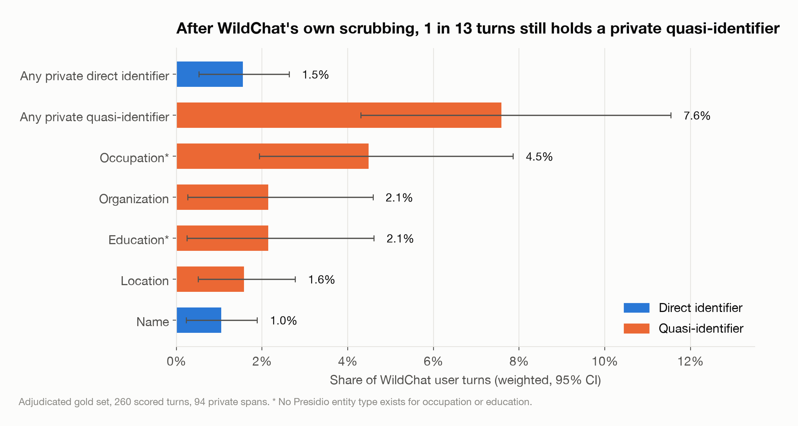
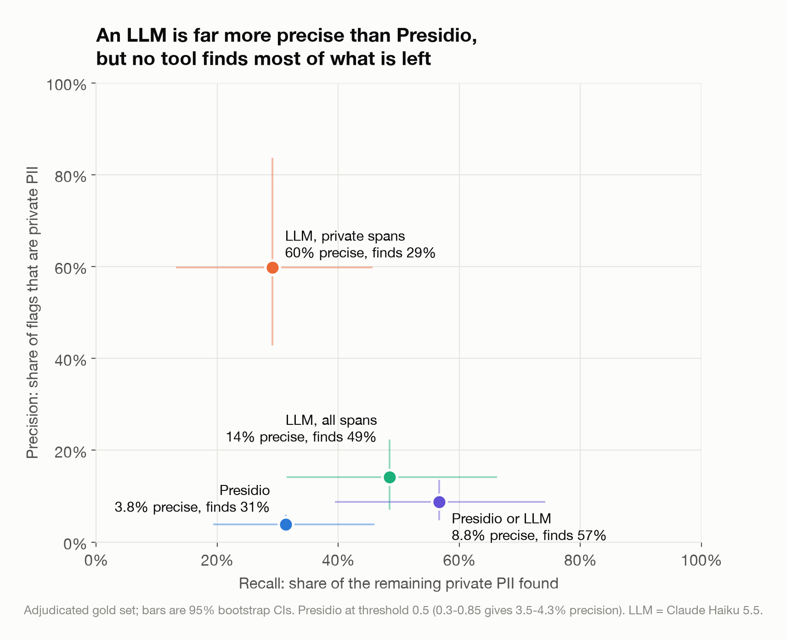
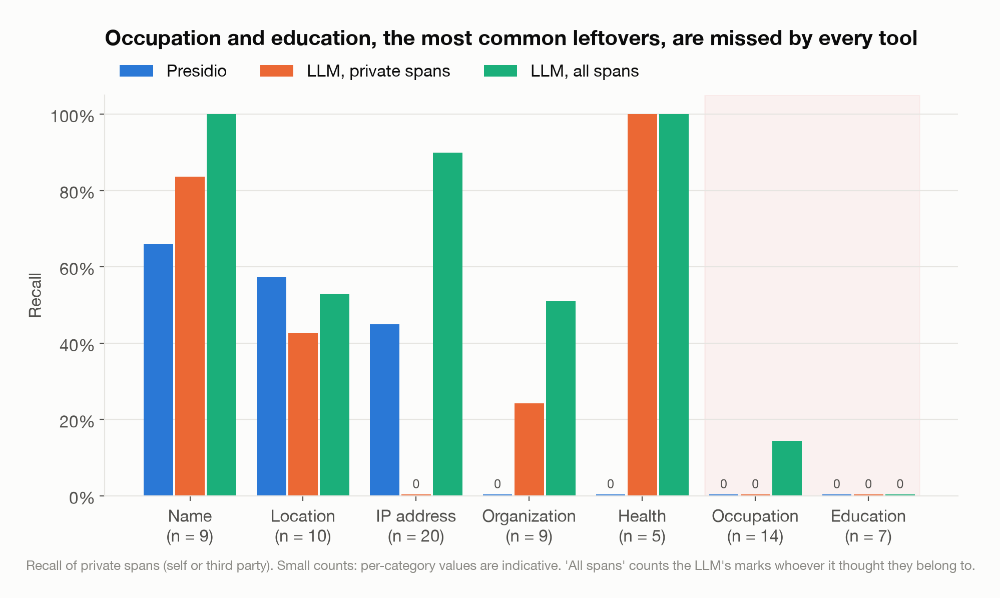
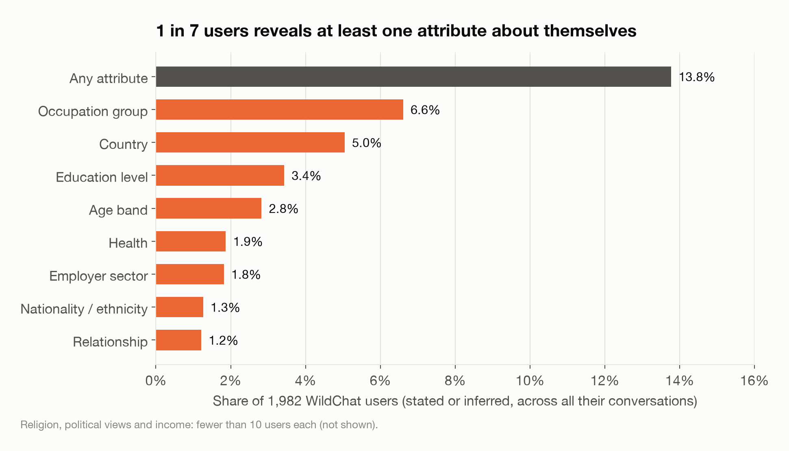
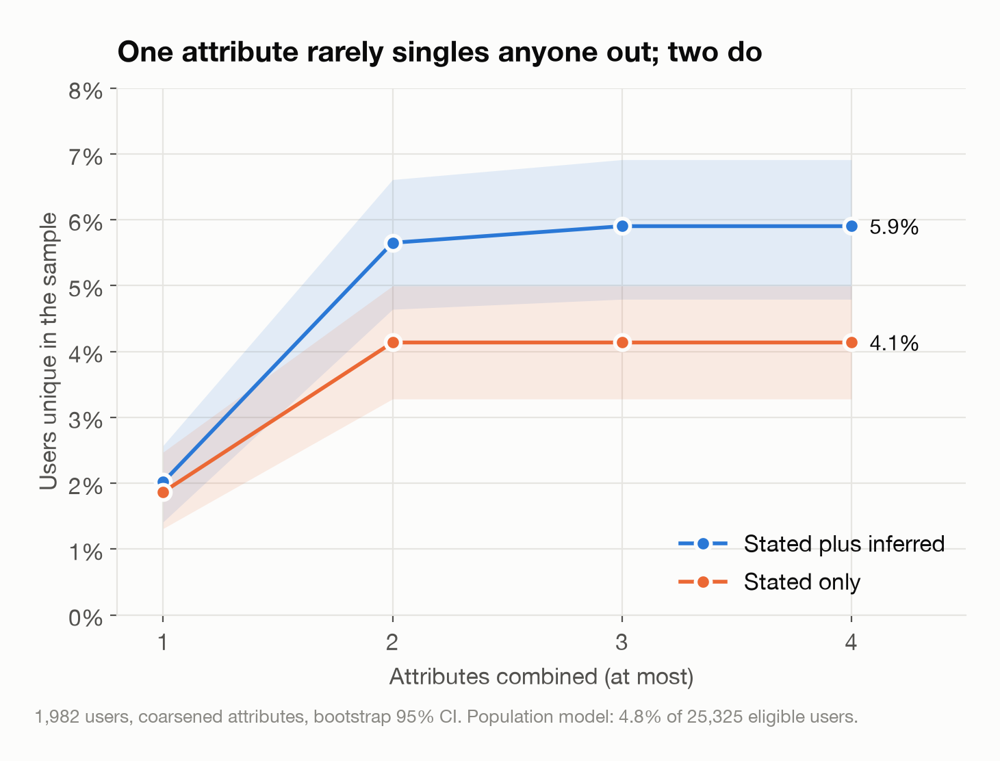
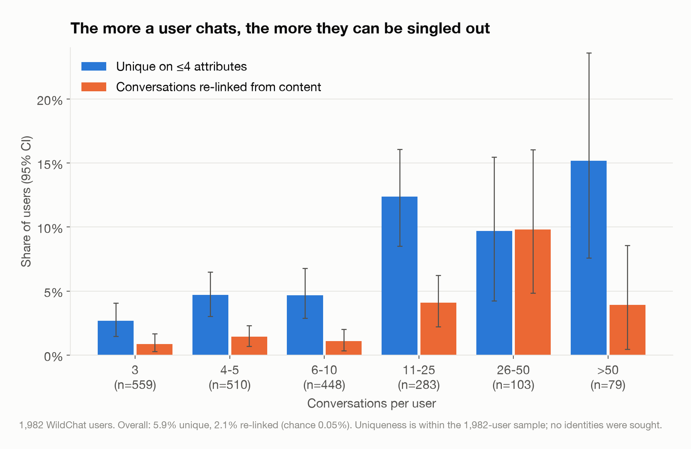
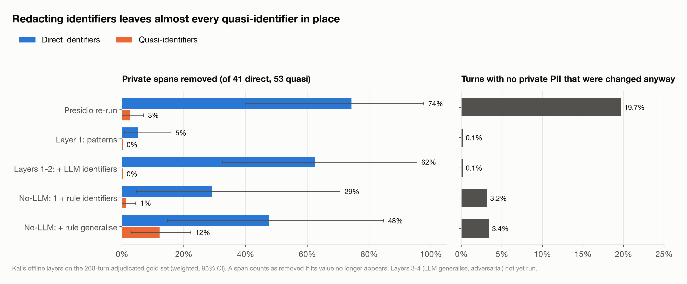
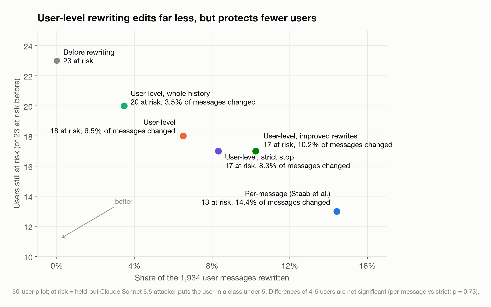
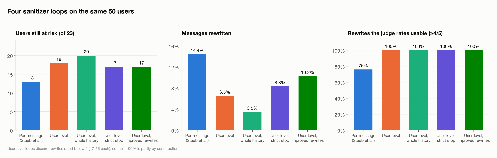
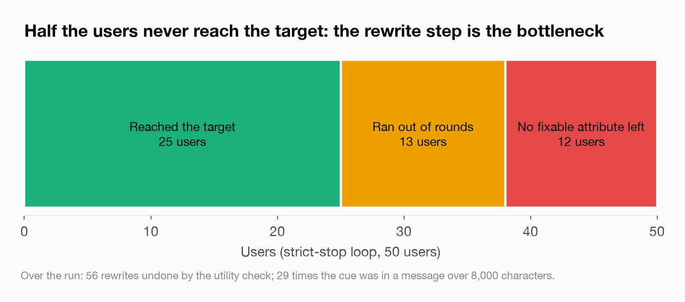

# Findings: residual personal information in public LLM chat logs

A synthesis of Stages 1–3 for the final presentation. Every number comes from aggregate tables in
`results/`. The figures are in `results/presentation/figures/` and are rebuilt with
`.venv/bin/python -m residpii.presentation`. Details are in
[stage1_results.md](stage1_results.md), [stage2_results.md](stage2_results.md) and
[adversarial_pilot.md](adversarial_pilot.md). The data is WildChat only. No identity was looked up.

## The answer in four lines

1. **What is left.** WildChat's own scrubbing leaves private information in about 1 in 13 user turns. Most of it is quasi-identifiers such as occupation, education and location, not names or emails.
2. **Can tools find it.** No. Presidio's flags are 96% false alarms, and it finds 31% of what is left. An LLM is 16 times more precise but finds no more, and every tool misses occupation and education.
3. **Across conversations.** Linking a user's conversations, as the released hashed IP allows, is where the risk builds. 6% of users are unique on what they reveal, rising to 15% of heavy users. For 2% of users, their conversations can be tied back together from content alone.
4. **Can a sanitizer fix it.** Not by redacting identifiers, which removes none of the quasi-identifiers. Kai's full four-layer sanitizer removes 84% of private direct identifiers and 63% of quasi-identifiers on the gold set. It changes fewer clean turns than a Presidio re-run and damages fewer requests. A sanitizer that works on the whole user rewrites about half as many messages as the per-message loop (Staab et al.), and its rewrites stay usable. In a 50-user pilot it protected fewer users, but the gap is not significant. The limit is now the rewrite step, not the idea.

## Research questions and answers

| # | Question | Answer | Confidence |
|---|---|---|---|
| RQ1 | How much personal information remains after WildChat's scrubbing, by type? | 7.6% of turns hold a private quasi-identifier and 1.5% a private direct identifier. Occupation (4.5%) is the largest category. | Medium: 260 gold turns, wide CIs |
| RQ2 | How accurate is each detection layer, and what does each miss? | Presidio: 3.8% precise, 31% recall. LLM: 60% precise, 29% recall. Together they reach 57% recall at 8.8% precision. Occupation and education are 0–14% everywhere. | Overall figures are robust; per-category figures are indicative |
| RQ3 | How much more does a user expose across conversations than in one? | One attribute singles out 2% of users and two attributes 5.9%. Uniqueness rises from 3% of users with 3 conversations to 15% of those with over 50. 2.1% can be re-linked (chance: 0.05%). | Medium: extractor recall is 29% |
| RQ4 | Can a sanitizer leave less behind, and at what cost? How much stays inferable? | On the gold set, layers 1–2 remove 62% of private direct identifiers and 0% of quasi-identifiers. All four layers remove 84% and 63%, change 14% of clean turns and rate 97% of turns still usable; a held-out attacker's confident inferences fall from 10.5% of turns to 5.8%. After direct identifiers are removed, a held-out attacker still puts 23 of 50 pilot users at risk. The per-message loop leaves 13, and the best user-level loop leaves 17 while changing 42% fewer messages. | Gold-set layers: medium. Loops: pilot only (p = 0.73) |

---

## RQ1: What remains after scrubbing?

| Category | Share of turns | 95% CI |
|---|---|---|
| Any private quasi-identifier | 7.6% | 4.3–11.5% |
| Occupation | 4.5% | 1.9–7.9% |
| Organization | 2.1% | 0.3–4.6% |
| Education | 2.1% | 0.2–4.6% |
| Location | 1.6% | 0.5–2.8% |
| Any private direct identifier | 1.5% | 0.5–2.6% |
| Name | 1.0% | 0.2–1.9% |

**What it means.** WildChat's scrubbing targets direct identifiers, and those are mostly gone.
Quasi-identifiers are about five times as common. The two most common, occupation and education,
cannot be caught by its tool because Presidio has no entity type for them. The real problem is
not names and emails slipping through. It is the details people share about their lives, which
nobody tries to remove.

## RQ2: How well do detection tools find what is left?

| Detector | Precision | Recall | Flags on 260 turns |
|---|---|---|---|
| Presidio (threshold 0.5) | 3.8% | 31% | 721 |
| LLM, spans it judged private | 60% | 29% | 46 |
| LLM, every span it marked | 14% | 49% | 248 |
| Presidio or LLM | 8.8% | 57% | 1,020 |

**What it means.**
- **Presidio mostly flags the wrong things.** 96 of every 100 flags are fictional characters,
  public figures or non-personal text, and changing its threshold does not help (3.5–4.3%
  precision from 0.3 to 0.85). Re-running the tool WildChat used would remove under a third of
  what is left.
- **The LLM's gain is judgement, not coverage.** It can tell the writer and real people apart
  from characters and celebrities (81% precision on names). It finds about as much as Presidio.
- **Much of what the LLM "misses" it actually saw.** It found 90% of IP addresses and 100% of
  names, but often judged them not private. Recall rises from 29% to 49% when ownership is
  ignored, so the main disagreement with the annotators is *whose* information it is.
- **Everyone misses occupation and education.** These are the most common categories, and every
  tool scores 0–14% on them. They are also exactly what makes users unique in RQ3.

## RQ3: How much more does a user expose across conversations?

| Conversations per user | Users | Unique (≤4 attributes) | Re-linked from content |
|---|---|---|---|
| 3 | 559 | 2.7% | 0.9% |
| 4–5 | 510 | 4.7% | 1.4% |
| 6–10 | 448 | 4.7% | 1.1% |
| 11–25 | 283 | 12.4% | 4.1% |
| 26–50 | 103 | 9.7% | 9.8% |
| >50 | 79 | 15.2% | 3.9% |
| **All** | **1,982** | **5.9%** (population model: 4.8%) | **2.1%** (chance 0.05%) |

**What it means.**
- **Risk is in the combination, not the message.** One attribute rarely singles anyone out (2%).
  Two coarse ones, such as an occupation group and a country, do so for 5.9% of users. This holds
  even with every value reduced to a broad category.
- **Accumulation is the main risk.** Heavy users reveal more and are about five times as likely
  to be unique as light users. The hashed IP that WildChat releases is what lets those
  conversations be pooled.
- **Content alone can re-link conversations.** This happens about 40 times as often as chance,
  mostly through direct identifiers. Where both halves of a user's history reveal something,
  31% are re-linked.
- **This is a floor in practice, though not a strict bound.** The extractor finds only 29% of
  gold attributes (11% of occupations), so real profiles are richer. It also makes errors in the
  other direction (40% precision).

## RQ4: Can a sanitizer protect users, and at what cost?

### Kai's layered sanitizer on the gold set

Kai's sanitizer (`residpii sanitize`) applies cumulative layers:
1. patterns (emails, phones, keys, paths);
2. direct identifiers the LLM detector judged private;
3. LLM generalising ("a nurse in Leeds" becomes "a healthcare worker in the UK");
4. the per-message adversarial loop.

It also has an alternative without an LLM, built from spaCy and lookup tables. A private gold span
counts as removed if its exact value no longer appears in the sanitized text. A held-out attacker
(Claude Sonnet 5.5) also tries to infer attributes from each sanitized turn, and a judge (Haiku)
rates whether the request can still be answered. Layers 3–4 cost $4.93 for the 260 turns.

| Stage (cumulative) | Direct removed (of 41) | Quasi removed (of 53) | Clean turns changed | Redactions that hit no private span |
|---|---|---|---|---|
| WildChat as released | 0% | 0% | 0% | |
| Presidio re-run | 74% | 3% | 19.7% | 97% of 421 |
| Layer 1: patterns | 5% | 0% | 0.1% | 56% of 27 |
| Layers 1–2: + LLM identifiers | 62% | 0% | 0.1% | 23% of 39 |
| Layers 1–3: + LLM generalise | 84% | 12% | 9.9% | |
| Layers 1–4: + adversarial loop | 84% | **63%** | 14.4% | |
| No LLM: 1 + rule identifiers | 38% | 1% | 6.1% | 92% of 115 |
| No LLM: + rule generalise | 57% | 12% | 6.3% | 84% of 142 |

| Stage | Turns rated worse (judge <4/5) | Turns with a confident inference (held-out attacker) | Original inferences still made |
|---|---|---|---|
| WildChat as released | | 10.5% | 100% of 52 |
| Presidio re-run | 7.7% | 10.5% | 50% |
| Layers 1–2 | 0.0% | 11.9% | 55% |
| Layers 1–3 | 0.3% | 11.9% | 46% |
| Layers 1–4 | 3.2% | **5.8%** | **5%** |
| No LLM: + rule generalise | 1.7% | 9.9% | 48% |

Sources: `results/default/tables/sanitizer_leakage.csv`, `sanitizer_overredaction.csv`,
`sanitizer_exposure.csv` and `sanitizer_utility.csv` (gold = adjudicated), with weighted 95% CIs.
The intervals are wide (layers 1–4, quasi removed: 39–83%).
The rule-based rows use Kai's latest rules, which keep public figures, fictional characters and
common first names, and redact names outside stories. Compared with his earlier rules, they remove
more direct identifiers (38% against 29%) but change twice as many clean turns (6% against 3%).

**What it means.**
- **The LLM layer is the precise way to remove identifiers.** Layers 1–2 remove nearly as many
  direct identifiers as a Presidio re-run (62% against 74%). They change 0.1% of clean turns,
  where Presidio changes 20%, and 77% of their redactions hit real private PII, against 3% for
  Presidio.
- **No identifier layer touches quasi-identifiers.** 100% of private occupation, education,
  location and similar spans survive layers 1–2.
- **Generalising alone barely helps.** LLM generalising (layer 3) removes only 12% of
  quasi-identifiers, the same as the rule-based version, while changing 10% of clean turns.
- **The adversarial loop does the work.** Layer 4 removes 63% of quasi-identifiers. The held-out
  attacker still makes only 5% of the inferences it could make from the original text, and turns
  with any confident inference halve (10.5% to 5.8%).
- **The full pipeline costs less than Presidio.** Layers 1–4 change fewer clean turns (14% against
  20%) and damage fewer requests (3.2% against 7.7% rated below 4), while removing more on both
  tiers.
- **Caveats.** Removal is an exact-string check, so a paraphrase that keeps the meaning counts as
  removed. The attacker result is the better guide to what stays inferable. The sample is small
  (53 quasi-identifier spans in 24 turns). The judge is a cheap model and rates nearly everything
  usable.

### Protecting users, not messages

The RQ3 finding motivates the design: protect the **user**, not the message. The user-level loop
pools what an attacker infers across all of a user's messages. It removes the attribute whose
removal makes the user least unique, and it rewrites only the messages that reveal that attribute.
A rewrite is kept only if a judge rates it usable. It is compared with the per-message loop of
Staab et al. (Kai's layer 4), and both are graded by a stronger held-out attacker that neither loop
sees.

| Version | Still at risk (of 23) | Messages rewritten | Edit size | Usefulness (1–5) | Rewrites rated ≥4 |
|---|---|---|---|---|---|
| Before rewriting | 23 | 0 | | | |
| Per-message (Staab et al.) | **13** | 279 (14.4%) | 18% | 4.1 | 76% |
| User-level | 18 | 126 (6.5%) | 12% | 4.6 | 100% |
| User-level, whole history | 20 | **67 (3.5%)** | 10% | 4.6 | 100% |
| User-level, strict stop | 17 | 161 (8.3%) | 12% | 4.6 | 100% |
| User-level, improved rewrites + passages | 17 | 198 (10.2%) | 13% | 4.5 | 100% |

**What it means.**
- **A lot stays inferable after standard scrubbing.** With direct identifiers removed (Kai's
  layers 1–2), the held-out attacker still narrows 23 of 50 pilot users to a class under 5.
- **Targeting cuts the cost of protection.** The user-level loops change half as many messages or
  fewer, make smaller edits, and keep every rewrite usable. The per-message loop rewrites anything
  with a confident inference, and one in four of its rewrites makes the request worse.
- **The per-message loop protects more users, but not significantly.** 13 against 17 users is a
  difference of 4 users out of 23, with p = 0.73.
- **A loop is only as good as its attacker.** Rewrites that fool the in-loop Haiku attacker do
  not always fool the held-out Sonnet. The strict stop, which requires both in-loop attackers to
  agree and uses a class of at least 10, cut false "safe" calls to 1.
- **The bottleneck is now rewriting.** Half the users never reach the target. 56 rewrites were
  undone by the utility check, and 29 times the cue sat in a message too long to rewrite.

---

## What this means overall

- **Released chat logs are not de-identified in the sense that matters.** Direct identifiers are
  largely gone. The information that lets someone be singled out (occupation, education,
  location, health) remains, and it is not what the scrubbing was built to catch.
- **Per-message tools are the wrong unit.** Risk builds up across a user's conversations, and
  releasing a user-linking key such as `hashed_ip` turns many harmless messages into one
  identifying profile. Dataset releases should weigh that key's research value against this risk.
- **Better detectors help precision, not coverage.** An LLM removes most of Presidio's false
  alarms, but neither finds most of what is left. Detection alone will not close the gap.
- **User-level sanitizing is promising but unfinished.** It is cheaper per message protected and
  keeps text usable. It needs a stronger rewrite step, and a stronger in-loop attacker, before it
  can match the per-message loop on protection.

## Limitations to state on the slides

- The study covers one dataset (WildChat), a 260-turn gold set, 1,982 users and a 50-user pilot.
  Per-category and pilot differences are within noise.
- Gold attributes come from one annotator. Agreement on quasi-identifiers was moderate (κ 0.41).
- The extractor is weak (29% recall, 40% precision), so uniqueness is not a clean bound either way.
- `hashed_ip` is a rough user proxy: shared IPs merge people, and changing IPs split them.
- Uniqueness is measured within the sample. It means a user can be distinguished, not identified.
  No one was identified.
- Every attacker and judge is an LLM. Rewrite usefulness is one model's rating, not a user study.
- The LLM detector is not deterministic. Two separate Haiku runs over the same 11,436 turns agree
  on full-sample prevalence: 4.3% and 4.5% of conversations have a private direct identifier. They
  disagree on individual gold spans, though, enough to move layer-2 leakage on 24 spans from 16% to
  52%. All gold-set numbers here use our run.
- Third-party spans are 9 of the 94 private gold spans, in 4 turns. Counting only the writer's own
  spans moves LLM precision from 60% to 54%, LLM recall from 29% to 25% and Presidio recall from
  31% to 30%, all well inside the confidence intervals.
- Stage 2 includes turns that repeat a shared prompt (13% of its turns, mostly one user reusing
  their own prompt). Dropping them leaves uniqueness at 5.9%.
- All models ran at low or medium effort and with cheap tiers. The total API spend was about $23.

## Next steps

1. A stronger rewrite step (gentle retries, more rounds, rewriting long messages passage by passage)
   did not protect more users: the remaining at-risk users reveal details their requests depend on,
   and every rewrite that hid them was rejected as unusable (`docs/adversarial_pilot.md`). Next:
   generalise such details instead of removing them.
2. Use a stronger attacker inside the loop (Sonnet, with Opus held out), at about $15–20.
3. Re-run the chosen loop on 200 or more users so the differences can be tested.
4. Build a larger, two-annotator gold set for attributes.
